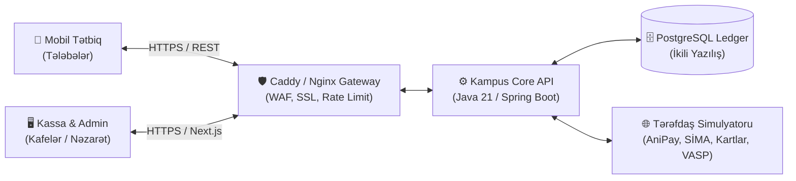

# KAMPUS — Ekosistem Təqdimatı (Slide Deck & Pitch Script)

> **Mövzu:** Tələbələr üçün Rəqəmsal Maliyyə Ekosistemi və Neobank Platforması  
> **Müəllif:** Sərxan Babayev & Kampus Mühəndislik Komandası  
> **Tarix:** Oktyabr 2026  
> **Canlı Platforma:** Admin & Kassa: `https://cbar.sarkhan.az` | Backend API: `https://apicbar.sarkhan.az` | Android APK: `https://cbar.sarkhan.az/download/kampus.apk`  

---



---

## 📑 Slaydların İcmalı

1. [Slayd 1: Titul və Ekosistem Vizyonu](#slayd-1-titul-və-ekosistem-vizyonu)
2. [Slayd 2: Problem — Tələbə Maliyyəsinin Gizli Qaranlıq Tərəfi](#slayd-2-problem--tələbə-maliyyəsinin-gizli-qaranlıq-tərəfi)
3. [Slayd 3: Həllimiz — Kampus 360° Rəqəmsal Cüzdan](#slayd-3-həllimiz--kampus-360-rəqəmsal-cüzdan)
4. [Slayd 4: Ekosistemin Tam Arxitekturası](#slayd-4-ekosistemin-tam-arxitekturası)
5. [Slayd 5: Onboarding & Təhlükəsizlik — eKYC və Adaptiv GMA](#slayd-5-onboarding--təhlükəsizlik--ekyc-və-adaptiv-gma)
6. [Slayd 6: Gündəlik Əməliyyatlar — Bir Toxunuşla P2P və Split Bill](#slayd-6-gündəlik-əməliyyatlar--bir-toxunuşla-p2p-və-split-bill)
7. [Slayd 7: Virtual Kartlar — 400 AZN-lik Dərsin Həlli](#slayd-7-virtual-kartlar--400-azn-lik-dərsin-həlli)
8. [Slayd 8: Kredit və Tələbə Dəstəyi — Sonra Ödə (BNPL) & Kredit Vitrini](#slayd-8-kredit-və-tələbə-dəstəyi--sonra-ödə-bnpl--kredit-vitrini)
9. [Slayd 9: Rəqəmsal Aktivlər — USDT Kripto Pilotu](#slayd-9-rəqəmsal-aktivlər--usdt-kripto-pilotu)
10. [Slayd 10: Tənzimləyici Uyğunluq və Ledger Mühasibatlığı](#slayd-10-tənzimləyici-uyğunluq-və-ledger-mühasibatlığı)
11. [Slayd 11: Biznes və Nəzarət — Kassa və Admin/Compliance Portalı](#slayd-11-biznes-və-nəzarət--kassa-və-admincompliance-portalı)
12. [Slayd 12: Texnoloji Stek və DevOps Klasteri](#slayd-12-texnoloji-stek-və-devops-klasteri)
13. [Slayd 13: Biznes Modeli və Monetizasiya Strategiyası](#slayd-13-biznes-modeli-və-monetizasiya-strategiyası)
14. [Slayd 14: Yol Xəritəsi və Yekun Çıxış](#slayd-14-yol-xəritəsi-və-yekun-çıxış)

---

### Slayd 1: Titul və Ekosistem Vizyonu

#### 📌 Slayd Məzmunu
* **Başlıq:** KAMPUS
* **Alt Başlıq:** Tələbələrin Rəqəmsal Maliyyə Ekosistemi
* **Şüar:** *"Gündəlik ödənişlər bir toxunuşla, təhlükəsizlik isə yalnız risk olduqda!"*
* **Tərkib:**
  * 📱 **Mobil Tətbiq (Android APK / React Native):** Tələbələr üçün gündəlik maliyyə mərkəzi.
  * 🖥️ **Admin & Kassa Portalı (Next.js):** Kafedə QR qəbul edən kassir və AML/Compliance nəzarətçisi.
  * ⚙️ **Core API & İdempotent Ledger (Spring Boot 3 / Java 21):** Mərkəzi Bank standartlarında bank mühasibatlığı.
  * 🌐 **Tərəfdaş Ekosistem Simulyatoru:** AniPay, Açıq Bankçılıq, SİMA, BOKT və VASP.

> **🗣️ Spiker Qeydi (Pitch Başlanğıcı):**  
> *"Hörmətli münsiflər və qonaqlar. Bu gün sizə sadəcə bir mobil tətbiq deyil, Azərbaycanın universitet gəncliyi üçün hazırlanmış ilk tamhüquqlu rəqəmsal maliyyə ekosistemini — KAMPUS-u təqdim edirik. Layihəmiz tələbənin gündəlik həyatındakı bürokratik və maliyyə maneələrini aradan qaldırır, eyni zamanda Mərkəzi Bankın ən sərt prudensial və təhlükəsizlik tələblərinə cavab verir."*

---

### Slayd 2: Problem — Tələbə Maliyyəsinin Gizli Qaranlıq Tərəfi

#### 📌 Slayd Məzmunu
1. **Rəsmi Gəlir və Ənənəvi Bank Maneələri:**
   * Tələbələrin 70%-dən çoxunun rəsmi iş yeri və gəlir arayışı yoxdur; banklar onlara kredit xətti və ya əlverişli şərtlər təklif etmir.
   * Bank kartı olmayan tələbə rəqəmsal iqtisadiyyatdan kənarda qalır.
2. **Onlayn Abunəlik Fırıldaqları və Şəxsi Təcrübə (400 AZN İtki):**
   * Tələbələr xarici təhsil platformalarına, süni intellekt alətlərinə (məs. Cursor, ChatGPT) kartlarını bağlayır.
   * Komandamızın üzvü hesab oğurluğu və icazəsiz abunəlik çəkilməsi nəticəsində təqaüdünün 400 AZN-ni bir gecədə itirdi. Çünki ənənəvi kartlarda satıcıya kilid və ya dərhal anomaliya aşkarlanması yoxdur.
3. **Sosial Ödənişlərdə Çətinlik (Hesab Bölmə):**
   * Universitet ətrafındakı kafelərdə 4-5 nəfərlik hesabın bölünməsi hələ də nağd pulla və ya yöndəmsiz kartdan-karta köçürmələrlə aparılır.
4. **Kiçik Bizneslər (Kafelər, Nüsxə Mərkəzləri):**
   * POS terminal aylıq icarə haqqı və yüksək ekvayrinq komissiyaları kiçik kampus obyektlərini nağda məcbur edir.

---

### Slayd 3: Həllimiz — Kampus 360° Rəqəmsal Cüzdan

#### 📌 Slayd Məzmunu
* **Sadə, Sürətli və İntuitiv:** 2 dəqiqəyə filial getmədən tam rəqəmsal hesab.
* **Ağıllı Risk Əsaslı Təhlükəsizlik:** Gündəlik kiçik ödənişlər (60 AZN-dək) və dostlara köçürmələr əlavə PIN/SCA tələb etmir; şübhəli və iri məbləğlərdə dərhal qoruma işə düşür.
* **Tələbəyə Özəl İnnovasiyalar:**
  * 🍕 **Hesabı Böl (Split Bill):** Bir neçə saniyəyə dostlar arasında bərabər/fərdi ödəniş sorğusu və canlı status.
  * 🛡️ **Satıcıya Kilidli Virtual Kartlar:** Yalnız təyin olunan satıcıda işləyən və aylıq limit qoyulan kartlar (Abunəlik oğurluğuna son!).
  * ⏱️ **5 Saniyəlik "Ləğv Et" İmkanı:** Səhv P2P köçürmə zamanı panikasız geri qaytarma.
  * 🏧 **15 Dəqiqəlik Nağd Terminal Kodu:** Kartı olmayan tələbə üçün nağd pulla cüzdan artırma.
  * 📚 **50 AZN "Sonra Ödə" (0% BNPL):** Təhsil materialları və gündəlik qidalanma üçün faizsiz dəstək.

---

### Slayd 4: Ekosistemin Tam Arxitekturası

#### 📌 Texnoloji Bloklar

```
┌────────────────────────────────────────────────────────┐
│                   İSTİFADƏÇİ TƏRƏFİ                    │
│  📱 React Native (Android)      🖥️ Next.js Web Portal │
└───────────────────────────┬────────────────────────────┘
                            │ HTTPS / REST (Argon2, Bearer)
┌───────────────────────────▼────────────────────────────┐
│         🛡️ REVERSE PROXY & GATEWAY (Caddy/Nginx)        │
│   • SSL/TLS 1.3 Termination    • WAF ModSecurity       │
│   • CORS & Rate Limiter        • Security Headers      │
└───────────────────────────┬────────────────────────────┘
                            │ Internal Network
┌───────────────────────────▼────────────────────────────┐
│           ⚙️ KAMPUS CORE API (Java 21 / Spring)         │
│   • GMA / SCA Dynamic Linking  • Fraud Risk Engine     │
│   • Virtual Card Manager       • BNPL & Portfolio Cap  │
│   • Split-Bill State Machine   • Open Banking Gateway  │
└─────────────┬────────────────────────────┬─────────────┘
              │ JDBC / Flyway              │ HTTP Proxy
┌─────────────▼──────────────┐ ┌───────────▼─────────────┐
│ 🗄️ POSTGRESQL ACID LEDGER   │ │ 🌐 PARTNYOR SİMULYATORU │
│ • İkili Yazılış (Double)   │ │ • AniPay (CBAR)         │
│ • HOLD / CAPTURE / RELEASE │ │ • SİMA eKYC & ASAN      │
│ • İdempotent Sorğu Keşi    │ │ • Mock Kart Şəbəkəsi    │
│ • Qoruma Hesabı (Reserve)  │ │ • Mock VASP (USDT AML)  │
└────────────────────────────┘ └─────────────────────────┘
```

* **Yüksək Dayanıqlıq:** Stateless backend arxitekturası, paralel tranzaksiyalarda optimistik və pesimistik kilidləmə (Row-level locking).
* **Heç Bir İtki Yoxdur:** Hər əməliyyat dərhal ledger səviyyəsində audit olunur.

---

### Slayd 5: Onboarding & Təhlükəsizlik — eKYC və Adaptiv GMA

#### 📌 1. Məsafədən Hesab Açma (eKYC + SİMA)
* **Telefon + SMS Doğrulama:** 6 rəqəmli OTP kodu.
* **FİN və Dövlət Reyestri:** Şəxsiyyət vəsiqəsi məlumatlarının dərhal yoxlanılması.
* **Canlılıq Yoxlaması (Liveness):** Kamera vasitəsilə təsadüfi hərəkətlərlə foto-maskalama hücumlarının qarşısının alınması.
* **SİMA İmza:** Müştəri müqaviləsinin hüquqi elektron imza ilə təsdiqlənməsi.
* **Yaş Məhdudiyyəti:** 18 yaşdan aşağı istifadəçilərə avtomatik qadağa.

#### 📌 2. Gücləndirilmiş Müştəri Autentifikasiyası (GMA / SCA)
* **CBAR Tələbi:** 60 AZN altındakı əməliyyatlar və etibarlı benefisiarlar (Trusted Beneficiaries) üçün təsdiqsiz axın.
* **Dinamik Əlaqələndirmə (Dynamic Linking):** SCA imzası məhz göndərilən məbləğə və alıcının hesabına kriptoqrafik bağlanır. Yolda məbləğ dəyişdirilə bilməz.
* **Cihaz Bağlanması:** Hesab unikal `X-Device-Id` ilə bağlanır.
* **Brute-Force Müdafiəsi:** 3 səhv PIN cəhdindən sonra 30 dəqiqəlik avtomatik dondurulma.

---

### Slayd 6: Gündəlik Əməliyyatlar — Bir Toxunuşla P2P və Split Bill

#### 📌 Əsas İnnovasiyalar
1. **Daxili P2P və AniPay:**
   * Alıcının telefon nömrəsi kifayətdir. Alıcı Kampusdadırsa dərhal, başqa bankdadırsa AniPay vasitəsilə ötürülür.
   * Alıcının adının təhlükəsiz maskalanmış önizləməsi (`Sərxan B.`).
2. **5 Saniyəlik "Ləğv Et" Buferi:**
   * "Göndər" düyməsinə basıldıqdan sonra ekranda 5 saniyəlik geri sayım başlayır. Səhv aşkar edildikdə bir toxunuşla əməliyyat dayandırılır və pul dərhal balansa qayıdır.
3. **Sosial Hesab Bölmə (Split Bill):**
   * İstənilən restoran/kafe ödənişindən sonra "Hesabı böl" seçimi.
   * Dostları siyahıdan seçmə, bərabər və ya fərdi məbləğ təyini.
   * Canlı izləmə: kim ödəyib, kim gözləyir.
4. **EMVCo Standartlı QR Ödənişlər:**
   * Mərkəzi Bankın tələbinə uyğun TLV (Tag-Length-Value) və CRC16 yoxlama nəzarəti.
   * Dinamik (məbləğli və 5 dəqiqəlik) və Statik (masadakı stiker) QR dəstəyi.

---

### Slayd 7: Virtual Kartlar — 400 AZN-lik Dərsin Həlli

#### 📌 Tələbələrin Onlayn Qalxanı
Komandamızın təcrübəsindən doğan 3 səviyyəli virtual kart arxitekturası:

| Kart Növü | Təyinatı | Təhlükəsizlik Mexanizmi |
| :--- | :--- | :--- |
| **1. Standart Virtual** | Ümumi onlayn alış-veriş | Tənzimlənən gündəlik və aylıq limitlər |
| **2. Satıcıya Kilidli (Merchant-Locked)** | Cursor, Spotify, Netflix abunəlikləri | **Yalnız ilk ödəniş edilən satıcıda işləyir.** Digər heç bir şirkət və ya fırıldaqçı bu kartdan pul çıxa bilməz! |
| **3. Birdəfəlik (Disposable)** | Güvənilməyən yeni saytlar | İlk uğurlu əməliyyatdan sonra kart avtomatik məhv olur |

* **Anomaliya Xəbərdarlığı:** Satıcı həmişəkindən fərqli məbləğ tələb etdikdə (məs. 20 USD əvəzinə 200 USD), ödəniş dərhal bloklanır və tələbəyə push bildiriş gedir.
* **"Bu mən deyiləm":** Şübhəli bildirişə toxunduqda kart 1 saniyədə dondurulur və mübahisə (dispute) işi açılır.

---

### Slayd 8: Kredit və Tələbə Dəstəyi — Sonra Ödə (BNPL) & Kredit Vitrini

#### 📌 1. "Sonra Ödə" (0% Kampus BNPL)
* **Həcm:** Tələbənin gündəlik xərcləri və təhsil ləvazimatları üçün 50 AZN-dək limit.
* **Müddət:** 30 və ya 60 gün sonra geri ödəmə, 0% faiz və komissiyasız.
* **Prudensial Uyğunluq (CBAR Qayda 9):**
  * Yalnız 18 yaşdan yuxarı və tam KYC keçmiş tələbələrə şamil olunur.
  * Vəsait müştəri cüzdanlarından deyil, **yalnız şirkətin öz nizamnamə kapitalından** təmin edilir.
  * Ümumi BNPL portfeli kapitalın **10%-ni** aşa bilməz (avtomatik sistem limiti).

#### 📌 2. Partnyor Kredit Vitrini (Marketplace)
* Noutbuk, telefon və ya təhsil haqqı kimi iri xərclər üçün banklar və BOKT-lar (Bank Olmayan Kredit Təşkilatları) cəlb olunur.
* Şəffaf müqayisə: Məbləğ, müddət, FİFD (Faktiki İllik Faiz Dərəcəsi) və aylıq ödəniş yan-yana göstərilir.
* Tələbədən heç bir faiz tutulmur — Kampus tərəfdaş maliyyə qurumundan yönləndirmə (Lead Fee) gəliri əldə edir.

---

### Slayd 9: Rəqəmsal Aktivlər — USDT Kripto Pilotu

#### 📌 Mərkəzi Bankın Sandbox Rejiminə Hazır Modul
* **Məqsəd:** Kriptovalyutası olan tələbənin kampus daxilində rahat ödəniş etməsi, lakin yerli biznesin heç bir bazar riski daşımaması.
* **Necə İşləyir?**
  1. Tələbə kafedə QR oxudur və "USDT ilə ödə" seçir.
  2. Sistem 30 saniyəlik zəmanətli məzənnə kilidi (Quote Lock) verir.
  3. Tələbənin USDT-si lisenziyalı VASP tərəfindən konvertasiya olunur.
  4. **Kassir hesaba dərhal milli valyutada — AZN olaraq vəsait qəbul edir!**
* **AML və Travel Rule:** Şübhəli və sanksiyalı blokçeyn ünvanlarından depozitlər dərhal bloklanır.
* **Tənzimləyici İdarəsi:** Defolt olaraq sönülüdür (Feature Flag). CBAR icazəsi alındıqda admin paneldən dərhal aktivləşdirilir.

---

### Slayd 10: Tənzimləyici Uyğunluq və Ledger Mühasibatlığı

#### 📌 1. İkili Yazılışlı İdempotent Ledger
* Pul heç vaxt adi `UPDATE balance = balance + 10` kimi artırılmır.
* Hər qəpik hərəkəti iki hesab arasında Debet və Kredit yazılışı ilə qeydə alınır:
  $$\sum \text{Debet} - \sum \text{Kredit} = 0$$
* Şəbəkə kəsildikdə və ya istifadəçi təkrar toxunduqda unikal `Idempotency-Key` sayəsində təkrar pul çıxılması 100% istisna edilir.

#### 📌 2. Qoruma Hesabı və Vəsaitlərin Ayrılması (Safeguarding)
* Müştərilərin bütün cüzdan vəsaitləri tərəfdaş kommersiya bankındakı xüsusi **Qoruma Hesabında (Safeguarding Account)** saxlanılır.
* Şirkətin əməliyyat xərcləri ilə müştəri pulları bir-birinə qarışmır.
* Hər gecə avtomatlaşdırılmış daxili ledger və bank çıxarışı üzləşdirməsi (Reconciliation) aparılır.

---

### Slayd 11: Biznes və Nəzarət — Kassa və Admin/Compliance Portalı

#### 📌 Rollara Əsaslanan Veb Portal (`https://cbar.sarkhan.az`)

```
┌─────────────────────────────────────────────────────────────┐
│                       KAMPUS NƏZARƏT                        │
├─────────────────┬─────────────────────────┬─────────────────┤
│  ADMIN          │  COMPLIANCE             │  MERCHANT       │
│  • Canlı dövriyyə│  • Şübhəli Fraud növbəsi │  • Kassa POS    │
│  • Sistem audit │  • CBAR prudensial norm │  • Dinamik QR   │
│  • Feature flags│  • AML / KYC Reyestri   │  • Geri qaytarma│
└─────────────────┴─────────────────────────┴─────────────────┘
```

* **Fraud Növbəsi:** Risk balı yüksək olan əməliyyatlar (məs. gecə yarısı böyük məbləğ, "uduş/kredit" qeydi) admin təsdiqinə düşür.
* **Kassa Ekranı:** Universitet bufeti və ya nüsxə mərkəzi heç bir bahalı avadanlıq almadan, sadəcə brauzerdə kassir ekranını açaraq ödənişləri 1 saniyədə qəbul edir.

---

### Slayd 12: Texnoloji Stek və DevOps Klasteri

#### 📌 Sənaye Standartlarında İnfrastruktur
* **Mobil:** React Native, Expo SDK 52, Android Native Release (arm64-v8a), Proguard/R8 optimizasiyası.
* **Veb & Kassa:** Next.js 15, React 19, Tailwind CSS.
* **Backend:** Java 21 LTS, Spring Boot 3, Spring Security (Argon2id), Hibernate JPA.
* **Verilənlər Bazası:** PostgreSQL 16, Flyway Versioned Migrations.
* **Təhlükəsizlik:** Caddy 2, Nginx, ModSecurity Core Rule Set, TLS 1.3.
* **Avtomatlaşdırma (CI/CD):**
  * 3 ayrı GitHub repozitoriyası (`cbarbackend`, `cbarfrontend`, `cbarmobile`).
  * GitHub Actions vasitəsilə avtomatik test, Docker build və VPS deploy.
  * Hər mobil yenilənmədə imzalanmış APK-nın birbaşa **Telegram Botu (`@cbarcicdbot`)** vasitəsilə komandaya çatdırılması.

---

### Slayd 13: Biznes Modeli və Monetizasiya Strategiyası

#### 📌 Gəlir Mənbələri
1. **Satıcı Ekvayrinq Komissiyası (0.8% - 1.2%):**
   * Ənənəvi bankların 2%-lik POS faizlərindən xeyli aşağıdır, kampus kafeləri üçün cəlbedicidir.
2. **Kredit Vitrini Komissiyası (Lead Generation):**
   * Tərəfdaş bank və BOKT-lardan rəsmiləşən hər tələbə krediti üçün 1.5% - 2.5% yönləndirmə haqqı.
3. **Virtual Kart Interchange Gəlirləri:**
   * Tələbələrin qlobal internet alış-verişlərində beynəlxalq kart şəbəkələrindən pay.
4. **B2B Universitet Xidmətləri:**
   * Tələbə yataqxanası, kitabxana cərimələri və universitet tədbir biletlərinin inteqrasiyası.

---

### Slayd 14: Yol Xəritəsi və Yekun Çıxış

#### 📌 İnkişaf Mərhələləri
* **Mərhələ 1 (Hazırkı Vəziyyət):** Tam işlək sandbox ekosistemi, VPS deploy, canlı Android APK, simulyasiya edilmiş dövlət və bank xidmətləri.
* **Mərhələ 2 (Q1 2027):** Real SİMA İmza, Mərkəzi Bankın Açıq Bankçılıq API-ləri və ilk tərəfdaş kommersiya bankı ilə inteqrasiya.
* **Mərhələ 3 (Q2 2027):** Xəzər Universiteti pilot layihəsi — 5,000 tələbə və kampus ətrafındakı 40 tərəfdaş nöqtə.
* **Mərhələ 4 (Q4 2027):** Bütün ölkə universitetlərinə vahid rəqəmsal tələbə kartı və cüzdanı kimi miqyaslanma.

> **🗣️ Yekun Söz:**  
> *"Kampus yalnız bir cüzdan deyil — gənclərin ilk maliyyə məktəbi və şəffaf rəqəmsal gələcəyidir. Diqqətiniz üçün təşəkkür edirik! Suallarınızı cavablandırmağa hazırıq."*
